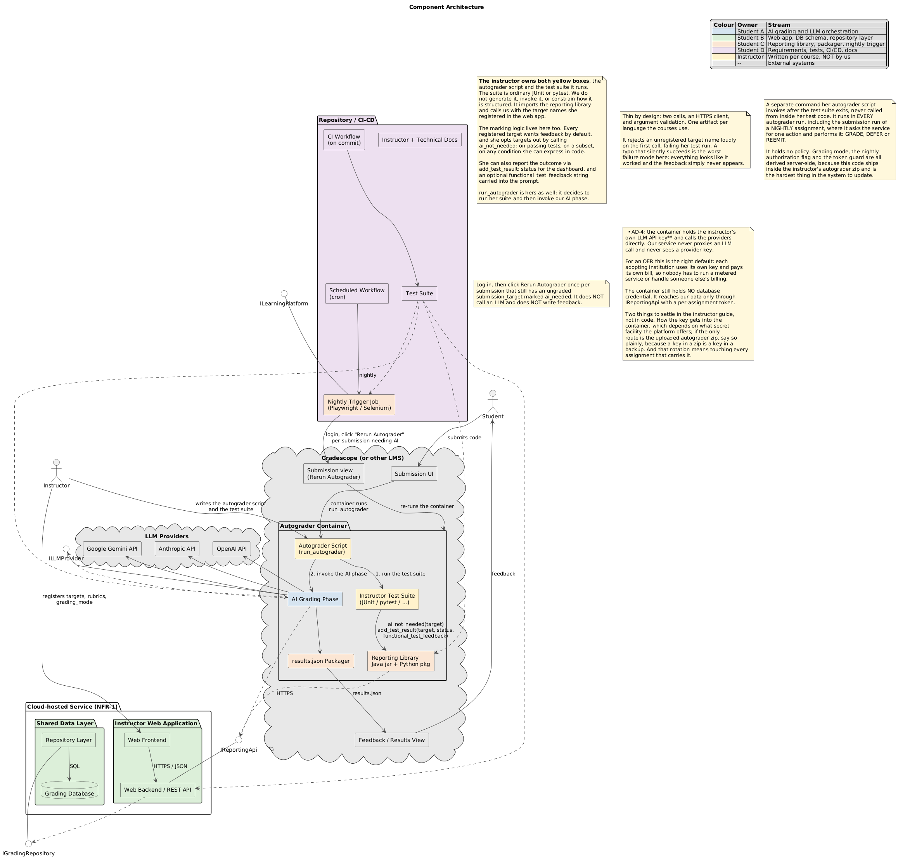

# Automated Code Feedback

## Overview

This is a cloud-hosted system that uses large language models (LLMs) to generate targeted feedback on student programming assignments.

The system integrates with Gradescope to process submissions, run functional tests, and generate feedback based on instructor-defined rubrics, test results, and student code. Feedback is stored in PostgreSQL and delivered through Gradescope.

## Features

- **Instructor Configuration:** Define grading targets, rubrics, and feedback guidance.
- **Automated Testing:** Run functional tests on student submissions.
- **LLM Feedback:** Generate targeted feedback using test results, rubrics, and source code.
- **Gradescope Integration:** Automate submission processing and feedback delivery.
- **Scheduled Workflows:** Coordinate nightly processing.
- **Cloud Hosting:** Deploy the application on Oracle Cloud Infrastructure.

## Architecture

The following diagram illustrates the system's main components and their interactions.

[View full-size diagram](docs/architecture/rendered/01-component.png)

## Technology Stack

| Component | Technology |
|---|---|
| Backend | FastAPI (Python) |
| Database | PostgreSQL |
| LLM Integration | Anthropic Claude API and/or OpenAI API |
| Workflow Testing | Playwright (TypeScript) |
| Python Testing | pytest |
| CI/CD and Scheduling | GitHub Actions |
| Cloud Hosting | Oracle Cloud Infrastructure (OCI) |

## How It Works

1. Instructors configure grading targets and rubrics.
2. A scheduled workflow identifies pending Gradescope submissions.
3. The system runs functional tests and records the results.
4. An LLM generates feedback using the rubric, test outcomes, and student code.
5. Feedback is stored in PostgreSQL and delivered through Gradescope.

## Project Status

This project is currently in development.