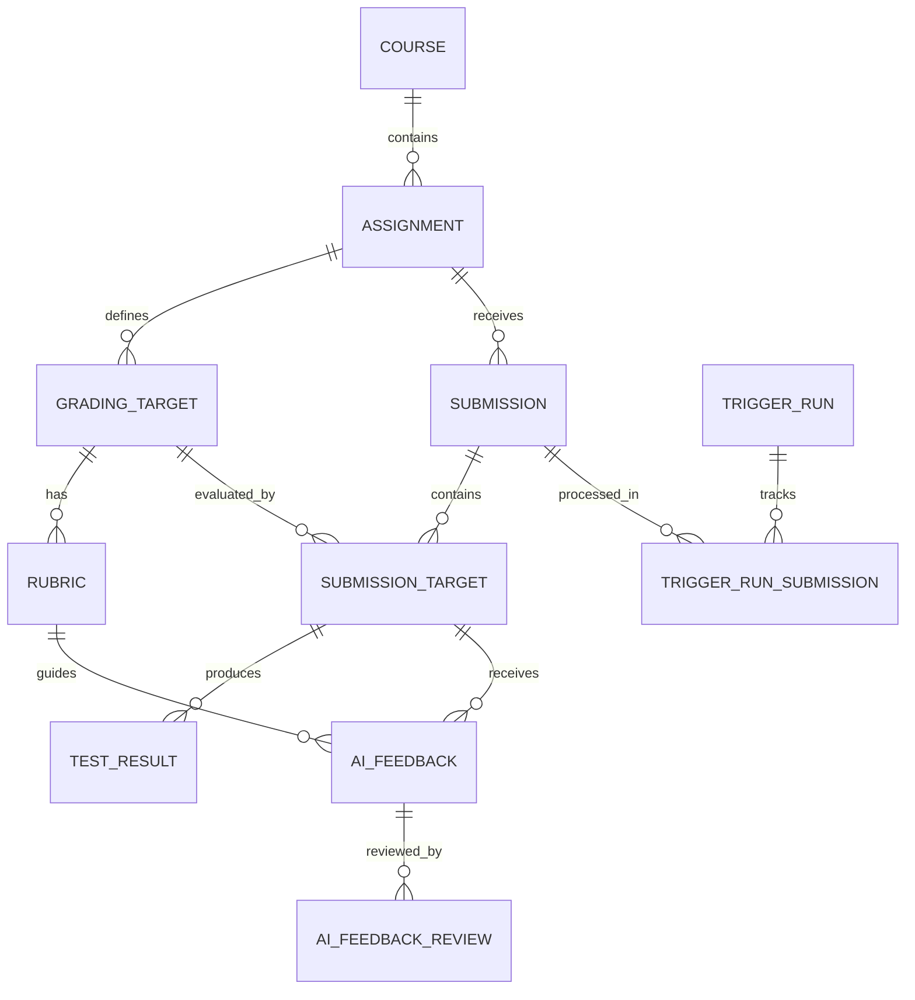

# Database Overview

## Purpose

The grading database stores the configuration, submissions, and results used by the automated grading system.

It manages the lifecycle of a student submission, from its association with an assignment through automated testing, AI-generated feedback, and instructor review.

The database uses **PostgreSQL**, with its schema defined through SQLAlchemy models in [`web/app/models.py`](../../web/app/models.py) and managed through Alembic migrations.

## How the Database Is Organized

The database can be understood in four main areas:

- **Course and Assignment Configuration:** Defines courses, assignments, grading targets, and the rubrics used to evaluate student work.
- **Submission Processing:** Tracks student submissions and the individual grading targets associated with each submission.
- **AI Feedback and Review:** Stores AI-generated feedback from different providers, suggested scores, and instructor reviews.
- **Execution Tracking:** Records scheduled or manually triggered grading runs and their outcomes.

## Database at a Glance

The following diagram illustrates the main entities and how they relate to one another.

Additional tables include:

- `instructor` – Instructor accounts for the web interface.
- `llm_provider_config` – Global configuration for available AI providers and models.

## Understanding the Submission Lifecycle

The central part of the database is the relationship between `submission` and `submission_target`.

When a student submission is received:

1. A `submission` record is created or updated.
2. A `submission_target` record is created for each grading target defined for the assignment.
3. Functional test results are recorded against individual submission targets.
4. AI-generated feedback is stored against each submission target, including the rubric and provider used.
5. Selected feedback can be reviewed by an instructor.

Importantly, test results and AI feedback are associated with individual submission targets, rather than directly with submissions. This allows each part of an assignment to be evaluated and tracked independently.

## Schema Conventions

A few important conventions to know:

- Tables use UUID primary keys.
- Timestamps are timezone-aware.
- Enum-like fields use text columns with `CHECK` constraints rather than native PostgreSQL enums.
- Unique constraints and partial unique indexes enforce important business rules, such as allowing only one current rubric per grading target and one selected AI feedback record per submission target.

## Further Documentation

For implementation details, database management, migrations, application architecture, and grading pipeline behavior, see the [Web Application README](../../web/README.md).

The database entity relationship diagram is also documented in [`02-data-model.png`](../architecture/rendered/02-data-model.png).
